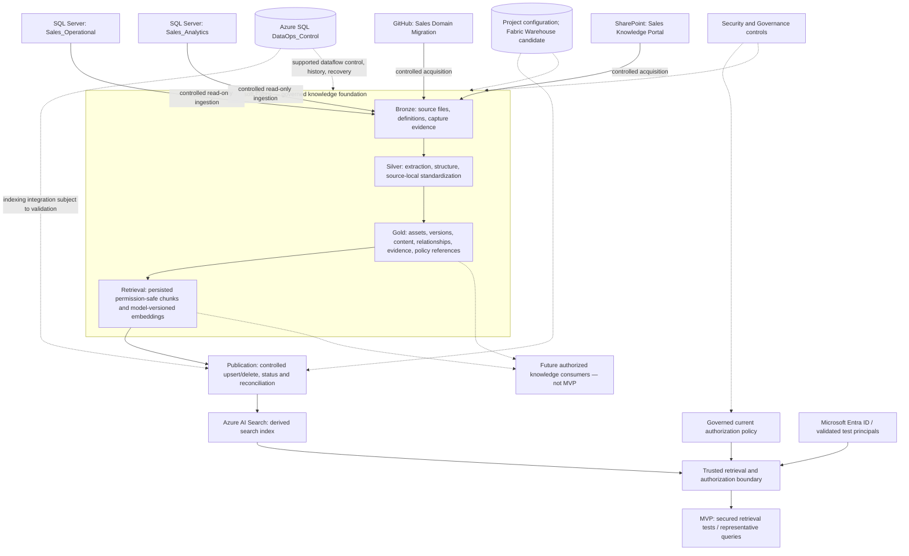

# Fabric Enterprise Knowledge Platform
## High-Level Solution Design (HLD) — v1.1 Consolidated

**Status:** Accepted architecture baseline — implementation validation pending; business/stakeholder approval not yet confirmed  
**Original consolidation date:** 2026-11-19  
**Baseline status updated:** 2026-11-23  
**Owner:** Solution Architect  
**Primary requirements:** Business Requirements Baseline v0.5 (draft for stakeholder approval)  
**Review inputs:** Data Architect, Senior Data Engineer, Security/Governance, AI/Search Engineer architecture reviews; QA Business Test Scenarios v1.0 (S01–S24)  
**Supersedes:** HLD v1.0 Draft

**Architecture review outcome:** Accepted by Data Architect, Senior Data Engineer, Security/Governance Specialist, and AI/Search Engineer in final HLD v1.1 alignment reviews. Supporting planning deliverables ACT-01 (architecture diagram), ACT-02 (environment/resource architecture), ACT-03 (Fabric resource design), and ACT-04 (Azure AI Search/embedding architecture) have been completed and accepted. This is an **implementation design baseline**, not evidence of deployed, validated, or production-approved controls. Business Requirements Baseline v0.5 retains its draft stakeholder-approval status.

## 1. Purpose and MVP boundary

Build a **centralized, governed and reusable Sales-domain knowledge foundation** in Microsoft Fabric, publish prepared knowledge to **Azure AI Search**, and validate secure, accurate retrieval. The MVP retrieves **existing indexed documents, excerpts, metadata and source evidence** in response to exact and natural-language queries; it **does not generate answers**, operate a conversational agent, or provide an employee-facing search application.

**Included:** Knowledge ingestion and extraction; Bronze/Silver/Gold processing; source identity, evidence, relationships, quality and lifecycle; persisted chunks and embeddings; Azure AI Search indexing; secure retrieval validation; operational monitoring, reconciliation and recovery.

**Excluded:** Transactional business rows; source-process execution history as searchable knowledge; AI-generated answers, agent/chatbot, employee-facing UI; source-system replacement; new ticketing application; financial ROI calculations.

### Confirmed knowledge sources

| Source | Knowledge scope | Architecture note |
|---|---|---|
| SQL Server 2022 — `Sales_Operational` | Tables, columns, views, functions, procedures, definitions and dependencies | Separate on-premises server; ~500 objects estimated |
| SQL Server 2022 — `Sales_Analytics` | Same metadata categories | Separate on-premises server; ~100 objects estimated |
| GitHub — Sales Domain Migration | In-scope source code, scripts, Markdown and technical documentation | Up to ~3,000 repository files estimated |
| SharePoint — Sales Knowledge Portal | Word, Excel and PowerPoint documents | ~500 Office documents estimated; some large/image-heavy |

Estimates are initial engineering inputs and require profiling. The **on-premises `DataOps_Control` database and its GitHub repository are excluded as knowledge sources**. The separate **existing Azure SQL `DataOps_Control`** is required operational infrastructure.

## 2. Architectural principles

1. **Source authority:** Source systems remain authoritative and are never modified by the knowledge platform. SQL Server represents observed deployed behavior, GitHub its repository baseline, and SharePoint documented business context; none is presumed universally correct.
2. **Operational isolation:** User retrieval never queries source systems; only approved background ingestion accesses sources.
3. **Fabric-centered, consumer-independent:** Fabric owns canonical curated knowledge; Azure AI Search receives derived retrieval assets. Other future consumers may reuse governed Gold or compatible Retrieval assets.
4. **Controlled copies and history:** Bronze is append-only for new/changed captures, subject to approved retention and mandatory deletion; unchanged content need not be copied again.
5. **Evidence and uncertainty:** Explicit relations and supported inferred links must be distinguishable; conflicting or incomplete knowledge is identified, not silently resolved.
6. **Secure by design:** Authorization applies to content, independent sections, chunks, metadata and results; sensitive content and derivatives are protected in all environments.
7. **Eventual consistency:** Target ≤60 minutes from detectable source change to searchable content, with measurable exceptions; urgent access revocations are not governed by that refresh interval.
8. **Independent recovery:** A failed source or item need not stop unrelated work; retain valid outputs, record failure state, and rerun only necessary dependency-aware work.
9. **Search as a derivative:** An index can be reconciled or rebuilt using retained governed Fabric assets, without re-ingesting sources when those assets are sufficient.

## 3. Consolidated logical architecture

**Diagram boundaries:** Solid arrows show intended MVP data flow; dashed arrows show operational controls, proposed dependencies or future reuse. The retrieval boundary is a **required logical security component**, not an employee UI. Its physical form (trusted API, gateway, policy service integration, or equivalent) and feasibility must be demonstrated. A search index alone does not enforce current user permissions merely by holding authorization fields.

## 4. Component responsibilities and contracts

| Component | Accountable for | Critical boundary / contract |
|---|---|---|
| Source owners / source systems | Authoritative content, corrections and approved access exceptions | Provide approved read-only integration paths; no user search-to-source access |
| Ingestion | Full initial inventory, change detection, originals/definitions, provenance | Independent per-source execution; validate completeness, pagination, permissions and removal signals |
| **Bronze** | Immutable new/changed captures, original Office files, SQL definitions and source metadata | Append-only logically; retention and mandatory deletion still apply |
| **Silver** | Complete supported text/structure extraction, metadata normalization, source-local references and extraction-quality states | No wholesale truncation or speculative cross-source interpretation; flag image-only/embedded limitations |
| **Gold** | Consumer-independent knowledge assets, full normalized content, source versions, current state, evidence, explicit/inferred relationships, sensitivity/policy links | Do not treat same-named assets as identical or inferred links as verified |
| **Retrieval** | Structure-aware chunks, embeddings and version/model metadata, provenance, current/history flags, effective security attributes | Chunk boundaries cannot mix incompatible permissions; retains enough content for future RAG inputs |
| **Publication** | Idempotent updates/removals, per-item results, retry/backlog, reconciliation and rebuild | Push to Azure AI Search preferred; validate API behavior, partial failures and lifecycle handling |
| **Azure AI Search** | Index, exact/keyword and natural-language discovery, relevance evaluation | Derived store; never sole source of truth; no generated answer requirement |
| **Trusted retrieval boundary** | Authenticate/authorize retrieval requests against **current effective policy**, filter results/snippets/metadata and fail closed | Next-request revocation enforcement must not depend on content/index refresh; no employee-facing app in MVP |
| **Azure SQL DataOps_Control** | Existing supported dataflow configuration, process hierarchy, execution plans/steps, items, reconciliation and errors | Index/search operation support is **not assumed**; define integration or separate telemetry as needed |
| **Project-owned configuration** | Admin-editable knowledge-policy and processing parameters, audit and effective dates | Fabric Warehouse preferred **candidate**, validate write permissions/audit/scheduling; separate from shared DataOps_Control |

### Gold minimum logical contract

Concepts: **KnowledgeAsset**, **AssetVersion**, **KnowledgeContent**, **KnowledgeRelationship**, **KnowledgeEvidence**. These are logical concepts, not mandated physical tables. Use source-qualified stable identifiers; record versions and `observed_at` separately from known source modification/deployment times; preserve provenance, conflict/verification status and available attribution evidence.

**Gold → Retrieval contract:** Asset/version IDs; complete governed text or stable content references; source and evidence links; typed relationships; quality state; content type/intended audiences; section IDs and classification/policy references; lifecycle/current/history flags; observed/synchronized timestamps. Intended audience can influence ranking **only after authorization**.

### Retrieval → Search contract

Publish stable chunk IDs; text; embeddings with model ID, dimensions and fingerprint; parent asset/version/section reference; permitted source evidence; current/history and quality indicators; security-policy references and search filters. Define document upsert/delete semantics, per-item publication state, reconciliation and searchable-time confirmation. Detailed schemas and models remain AI/Search design tasks.

## 5. Security and governance

- **Identity:** Microsoft Entra ID preferred. Central policies evaluate role, department, sensitivity and applicable source restrictions. Source-owner-approved exceptions can authorize **individual sections** of a more restricted document; deny contradictory/unknown access by default.
- **Section-level isolation:** Assign independent identities/classification where necessary. Chunks must not combine content with incompatible effective permissions, including neighboring text, snippets, metadata or source links.
- **Current-policy enforcement:** On **every retrieval request**, determine effective permissions from a trusted up-to-date authority. Permission revocation and policy unavailability must restrict/deny the next request rather than wait for an index refresh. Authorization-filtering and post-filtering strategies require a demonstrated no-leakage design.
- **Publication gate:** Require valid identity, provenance and classification/authorization before exposure. Critical security/validation failure blocks affected publication; acceptable partial content carries quality indicators.
- **Environment boundaries:** Development uses masked/synthetic sensitive material; production support needs scoped prior authorization. Privileged platform rights never implicitly authorize restricted knowledge. Protect intermediate artifacts, notebooks and logs.
- **Governance:** Source owners approve sharing exceptions and content retention rules; Security/Governance owns standards; designated admins update audited/versioned policies; engineering implements enforcement.
- **Audit:** Track policy changes, revocations, access denials, privileged activity, retrieval tests and security failures, without logging protected content unnecessarily. Persisted data also carries creation/modification audit metadata.
- **Deletion:** Restrict urgent sensitive content promptly, independently of routine source sync. Apply approved deletion/retention policy to persisted originals, Gold, Retrieval, index and other derivatives; record verifiable completion.

**Outstanding critical proof:** Demonstrate current-policy authorization and section-level safe retrieval with approved test principals, including grants, next-request revocations, unavailable policy service and a restricted parent document with an allowed subsection (QA S14–S17).

## 6. Change processing, completeness, quality and freshness

| Situation | Expected solution-level behavior |
|---|---|
| Initial load; one source unavailable | Independently available sources can publish permitted data; **overall MVP initial load remains incomplete** until four sources are integrated and validated |
| Critical designated file fails | Block affected initial publication as directed by source-owner rule; distinguish critical/noncritical outcomes |
| Noncritical extraction problem | Preserve original; record `Success / Partial / Failed / Skipped` item state and limitation; publish authorized, validated partial text with quality indicators where approved |
| Source or layer fails | Isolate unaffected work; retain valid previous searchable content when still authorized; checkpoint and rerun failed stages/items and actual dependents |
| Changed/renamed/deleted source asset | Compare source inventories/versions; preserve confirmed identity across rename, use new identity for unproven recreation; reprocess changed asset and affected dependencies |
| SQL/GitHub disagree | Preserve distinct observed source states; flag evidence-backed conflicts without automatically picking a winner |
| Search indexing partial failure/outage | Queue/record failed items; retry idempotently; verify index completeness, current lifecycle state, permission filtering and retrieval before declaring recovery |
| Current vs historical | Current content is search default; approved historical copies remain in Fabric, with a secure authorized investigation pathway. Full historical semantic indexing is **not assumed** |
| Routine refresh exceeds target | Record monitored exception; stakeholder elected **no user-facing warning** for routine delay in S24 |
| Source/processing failure impacts freshness | Expose affected freshness/quality state through operational or test metadata per S02/S03/S05; no employee-facing UI is created |
| Urgent security revocation/deletion | Enforce denial at next retrieval request; separately execute and verify physical deletion as governance policy requires |

**Freshness metric:** Measure detectable source change / available change evidence to successful availability in Azure AI Search, not only Fabric ingestion completion. Where source change time is unknown, distinguish observed time from actual change time; report measurement limitations. Initial **60-minute target** is configurable with audited administration; exceptions are monitored.

## 7. Search approach and MVP validation

- **Query baseline:** keyword/exact matching for SQL identifiers; test keyword + vector hybrid for paraphrased natural-language queries; optional semantic reranking only if relevance gains justify cost/latency.
- **Chunking:** structure-aware across SQL objects/code, Markdown sections, Word headings, Excel tables and PowerPoint slides; preserve full supported extractable text and parent/section references.
- **Index:** begin with a single logical chunk index containing text, vectors, content/source metadata, versions, quality and permission fields; validate before locking physical layout.
- **Role-aware ranking:** Technical or business content may rank differently for developer vs Sales analyst **after permission filtering**; never suppress other authorized results purely because of audience.
- **Missing evidence:** Return relevant existing evidence or a clear no-result/insufficient-evidence result. No fabricated summaries, cross-document generated explanations or AI agent in MVP.
- **Indicative targets (not approved):** exact identifier Recall@5 ≥95%; natural language Recall@5 ≥85%; MRR@10 ≥0.80; 100% valid references; zero unauthorized/deleted items in current search. Calibrate thresholds against a labeled dataset.

## 8. Architecture decisions and status

| ID | Decision / direction | Status |
|---|---|---|
| AD-001 | Centralized governed knowledge copies; no end-user operational-source queries | Accepted design baseline |
| AD-002 | Microsoft Fabric for canonical processing/storage, subject to assumed existing capacity and measured fit | Accepted design baseline; capacity proof open |
| AD-003 | Bronze raw/append-only → Silver extraction/normalization → Gold knowledge/evidence → Retrieval reusable chunks/embeddings | Accepted design baseline |
| AD-004 | Azure AI Search as MVP target; retrieval of **existing evidence**, not generated responses | Accepted design baseline; stakeholder approval pending |
| AD-005 | Push-based indexing of prepared, persisted Retrieval assets | Accepted design baseline; technical proof open |
| AD-006 | Gold consumer-independent; Azure AI Search derived/rebuildable; model-versioned Retrieval assets | Accepted design baseline |
| AD-007 | Evidence-linked relationships, source-specific authority, quality states and bounded history | Accepted design baseline; retention policy open |
| AD-008 | Existing Azure SQL DataOps_Control for supported dataflows; assess Search publication control separately | Accepted dependency; integration open |
| AD-009 | Centrally governed **section-level** access with request-time current authorization and fail-closed behavior | Accepted requirement; enforcement proof critical |
| AD-010 | Project-owned, administrator-editable configuration; Fabric Warehouse preferred candidate | Accepted design direction; write/audit/schedule feasibility open |
| AD-011 | Current results by default, governed historical copies retained in Fabric; historical retrieval path to be validated | Accepted principle; delivery choice open |
| AD-012 | Independent source/item recovery with partial publication and controlled criticality rules | Accepted design baseline; operational validation open |

**Approval language:** “Accepted” records specialist alignment on the implementation design baseline; it does **not** mean the component has been provisioned, tested, or approved for production. Open technical proofs remain listed below. Business Requirements Baseline v0.5 still carries draft stakeholder-approval status.

## 9. Open decisions, risks and validation owners

| Priority | Item | Owner / required evidence |
|---|---|---|
| **Critical** | Request-time effective authorization with section-level safe results, no metadata/snippet leaks and next-request revocation | Security/Governance + AI/Search + platform engineering; QA S14–S17 |
| High | Policy administration: source-owner approvals, classification scheme, retention periods and urgent deletion timing | Business/source owners + Governance; QA S11/S15–S18 |
| High | Source connectivity and representative extraction (especially SharePoint, image-heavy PPTX, large DOCX) | Data Engineer + source owners; QA S01/S07 |
| High | End-to-end index upsert/delete, partial-failure recovery, reconciled rebuild, no stale restricted results | AI/Search + Data Engineer; QA S21/S22 |
| High | Gold/section/policy contract and inference/version continuity | Data Architect + Security + AI/Search; QA S08–S12 |
| High | Historical investigation access in absence of employee application; clarify how MVP demonstrates authorized history | Data Architect + AI/Search + QA; QA S12 |
| Medium | DataOps_Control orchestration scope versus Azure AI Search publication/backlog telemetry | Data Engineer + AI/Search; QA S03/S22/S23 |
| Medium | Admin-editable project configuration in Fabric Warehouse, audited changes, scheduling synchronization | Data Engineer + Solution Architect; QA S23/S24 |
| Medium | Fabric capacity headroom; benchmark large Office files, ingestion concurrency and search size/cost | Platform + Data Engineer + AI/Search |
| Medium | Content-criticality configuration and difference between partial source publication and MVP sign-off | Source owners + Governance + QA; QA S01/S06 |
| Medium | Metric calibration for retrieval relevance and 60-minute measurable freshness | AI/Search + Data Engineer + QA; QA S19–S24 |
| Medium | Knowledge-issue assignment and verified closure without creating a ticketing product | Governance + Data Engineer; QA S13 |

### Explicit clarification, not a contradiction

QA S02/S03/S05 request freshness indications during known failures or updates, while S24 expressly rejects a **user-facing warning for routine delay**. Interpret these as two contexts: operational/test-visible status for affected failures, and no invented employee-facing notification feature for routine refresh. Confirm the exact metadata presentation in detailed design.

## 10. QA traceability and HLD acceptance gates

| QA group | Scenarios | Architectural evidence needed |
|---|---|---|
| Ingestion and processing | S01–S07 | Four-source inventory, independent runs, originals, validated extraction, item/stage reruns and reconciliations |
| Knowledge integrity and lifecycle | S08–S13 | Identity/provenance, inferred links, conflicts, selected history, delete/rename and issue workflow |
| Security and authorization | S14–S18 | Permission matrix, section exception, next-request revocation, fail-closed denial and privileged-environment protection |
| Search and retrieval | S19–S22 | Exact/paraphrased retrieval, role-aware relevance, source evidence, index updates and recoverable rebuild |
| Monitoring and operations | S23–S24 | Process/run/item health, operator reruns, notifications, configurable and measured freshness |

**Production readiness gate:** Specialist acceptance of this HLD permits DEV implementation planning; prior to production approval, obtain measured evidence for critical authorization controls, safe publication/deletion, viable source acquisition and meaningful retrieval quality; agree retention/security policy owners, and document residual risks. QA scenario acceptance is separate from architecture sign-off, and this HLD does **not** claim that scenarios have passed.

## 11. Recommended next activities

1. Commit this accepted HLD v1.1 as the **implementation design baseline**; retain ACT-01–ACT-04 as supporting records until documentation is consolidated.
2. Start a small DEV vertical slice using available SQL Server/GitHub sources and the approved Fabric Bronze → Silver → Gold → Retrieval → Search flow.
3. Prioritize a proof of **current-policy, section-safe authorization** with next-request revocation and fail-closed behavior before exposing restricted content.
4. Validate source extraction, index upsert/delete/rebuild, capacity and freshness; add SharePoint when a representative source becomes available.
5. Record implementation evidence and deviations, obtain outstanding business/policy approvals, and evaluate production readiness separately.

---

**Change summary vs v1.0:** Incorporated four specialist reviews and 24 stakeholder-reviewed QA scenarios; clarified retrieval-only MVP, section-level dynamic security, source-specific knowledge authority, complete-content preservation, independent/item-level recovery, Warehouse configuration candidate, historical retrieval boundaries, search lifecycle/rebuild, source profiling and measurable approval gates.

**Baseline status update (2026-11-23):** Four specialist HLD alignment reviews accepted; ACT-01–ACT-04 completed. No scope or fundamental architectural change is introduced by this status update. Technical/security validation and stakeholder approval remain outstanding.
